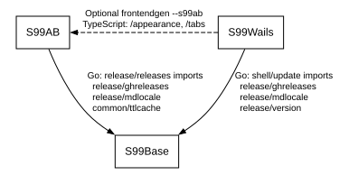
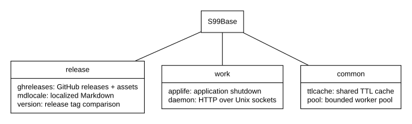

# S99Base

Shared Go building blocks for applications and libraries. The eight packages use only
the standard library and `golang.org/x/sync`, and do not import one another.

| Package | Purpose |
| --- | --- |
| [`release/ghreleases`](release/ghreleases) | Reads GitHub releases and repository stats; classifies assets by platform, architecture and kind, retaining digests. |
| [`release/mdlocale`](release/mdlocale) | Splits Markdown into per-locale sections opened by `<!-- lang:xx -->` lines. |
| [`release/pad`](release/pad) | Writes one release as a self-hosted PAD 3.11 XML listing for software directories; rejects copy that does not fit. |
| [`release/version`](release/version) | Compares release tags and trims one leading `v`. |
| [`work/applife`](work/applife) | Shuts an application down in reverse order under one deadline. |
| [`work/daemon`](work/daemon) | Runs HTTP over a Unix socket and starts the daemon on demand. |
| [`common/ttlcache`](common/ttlcache) | Holds one value behind a TTL; concurrent misses share one fetch. |
| [`common/pool`](common/pool) | Runs work through bounded goroutines, keeping input order. |

## Library relationships



Arrows point from the importer to its dependency. The Go libraries are independent
consumers of S99Base; neither S99AB nor S99Wails imports the other's Go module.

| Importer | S99Base imports | Source |
| --- | --- | --- |
| [S99AB](https://github.com/smegg99/S99AB) `release/releases` | `release/ghreleases`, `release/mdlocale`, `common/ttlcache` | [releases.go](https://github.com/smegg99/S99AB/blob/main/release/releases/releases.go), [downloads.go](https://github.com/smegg99/S99AB/blob/main/release/releases/downloads.go) |
| [S99Wails](https://github.com/smegg99/S99Wails) `shell/update` | `release/ghreleases`, `release/mdlocale`, `release/version` | [update package](https://github.com/smegg99/S99Wails/tree/main/shell/update) |

Both consumers currently require `github.com/smegg99/s99base v1.0.0`. Other
packages remain available for apps to import directly; these two libraries do
not currently use `common/pool`, `work/applife` or `work/daemon`.

S99Wails' optional `frontendgen --s99ab` output imports S99AB's TypeScript
`/appearance` and `/tabs` subpaths. That integration lives in the consuming
frontend, independently of the Go dependency graph.

## Package map



Diagram sources: [`docs/contents.dot`](docs/contents.dot) and [`docs/relations.dot`](docs/relations.dot).
Render with Graphviz: `dot -Tsvg docs/contents.dot -o docs/contents.svg`.

Package paths in the table above are relative to `github.com/smegg99/s99base`.
`ghreleases` also reads repository stars/forks and generated source archives.
`ttlcache` shares concurrent refreshes and serves the last good value if a
refresh fails. `version` compares release tags; it does not enforce strict
Semantic Versioning. `pad` accepts https URLs and OS names newer than PAD 3.11's
list, writes one optional public mailbox to every email field, and leaves contact
names and the postal address empty.

## Install

Requires Go 1.27. Detached daemon spawning requires Unix.

```sh
go get github.com/smegg99/s99base
```

## Checks

With Go, a C compiler for the race detector, and `just` installed:

```sh
just check
```

Runs formatting checks, `go vet`, and all tests with the race detector.

## License

[MIT](LICENSE).
